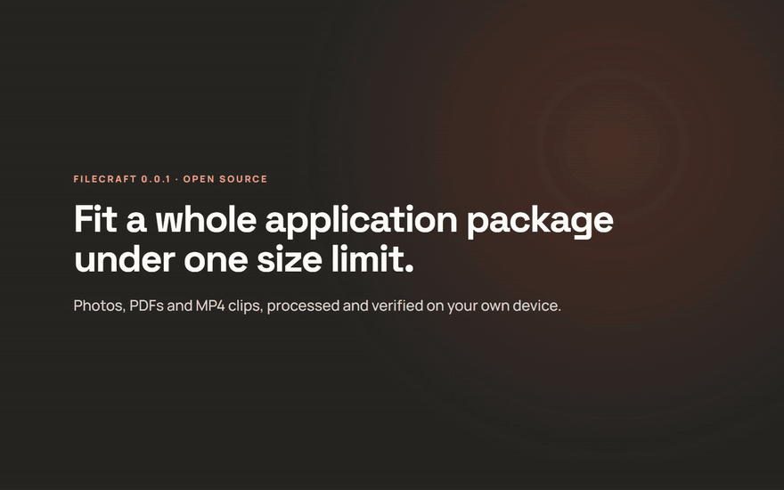

# FileCraft

**The private workbench for any file.**

FileCraft is a free, MIT-licensed desktop application and CLI for local, goal-driven file processing. Set one total size limit for a package of phone photos, scanned PDFs and video clips, then check the results before sharing.



<sub>Recorded from the Windows desktop app with synthetic files. Encoding is fast-forwarded. [How the demo is made](scripts/demo/README.md)</sub>

## What you can do

- Inspect the detected content type, byte size and SHA-256. Supported raster headers also expose dimensions, animation, alpha channel, ICC and EXIF probes.
- Set a per-file or whole-batch size limit. With JPEG, try several encodings and select from verified candidates. PNG and WebP encode losslessly.
- Choose **Mixed batch** for JPEG, PNG, WebP and HEIC photos, PDFs, and MP4 or MOV clips. FileCraft avoids lossy steps when everything already fits, then spends the budget where it buys the most quality:
  - Photos become JPEG above a 32 dB PSNR floor, keep their ICC color profile and lose EXIF data such as GPS positions. iPhone HEIC photos are converted to upright sRGB JPEGs.
  - Scanned PDFs have their page images downsampled to 200, 150 or 120 dpi. Every untouched object is checked to decode identically.
  - Phone videos, including HEVC and HDR clips from iPhones, become H.264/AAC MP4 at 1080p or 720p. Rotation is applied to the pixels and HDR is tone-mapped to SDR.
- Install the FFmpeg video engine with one click on Windows. It is pinned by size and SHA-256 and downloaded only when you ask for it.
- Keep transparency and orientation-corrected pixel dimensions. Retrieve before/after sizes, checksums, validation results and RGB PSNR in a JSON report. Byte-for-byte copies are reported explicitly.
- Reuse native UI presets or import and export versioned JSON recipes. Desktop and CLI use the same Rust engine.
- Save verified output as a new file. Originals and existing output files are preserved.

## Download

Windows x64 installers are on the [Releases](https://github.com/canblmz1/filecraft/releases) page. The installer is not code-signed yet, so Windows SmartScreen may ask for confirmation. Signing is prepared in the [release workflow](docs/development/SIGNING.md).

Photos and PDFs work right away. For MP4, MOV and HEIC, open **Engines** and select **Install** to download the pinned FFmpeg 9.1 build (about 120 MB), or run `filecraft engine install`. FileCraft also uses an FFmpeg 7.1+ with libx264, AAC and zscale that is already on PATH. On macOS and Linux, install FFmpeg with `brew install ffmpeg` or your package manager. macOS and Linux packages are not published yet, so build them from source.

## Run from source

Install Rust and Node.js 22, plus the platform [Tauri prerequisites](https://v2.tauri.app/start/prerequisites/). Dependency downloads are required for the first build. The packaged application runs using locally installed or bundled runtime components and has no account, telemetry, remote font or update client.

```bash
npm --prefix apps/desktop ci
cd apps/desktop
npm run tauri dev
```

Use **Browse files**, choose a format or a quick recipe, and select **Run & verify**. Choose an output folder when prompted. Job reports remain in the local desktop history.

### CLI

From the repository root, with an existing output directory:

```bash
cargo run --locked -p filecraft-cli -- capabilities
cargo run --locked -p filecraft-cli -- inspect photo.png scan.jpg
cargo run --locked -p filecraft-cli -- run --recipe recipes/small-attachments.json --output output photo.png scan.jpg
cargo run --locked -p filecraft-cli -- run --recipe recipes/application-package.json --output output IMG_0001.HEIC scan.pdf IMG_0002.MOV
cargo run --locked -p filecraft-cli -- engine status
cargo run --locked -p filecraft-cli -- engine install
```

CLI output is JSON. Exit codes are 0 (completed), 1 (failed/partial), or 130 (cancelled). Ctrl+C requests cooperative cancellation. The processing engine uses complete bytes and the desktop displays decimal MB.

### Build and test

```bash
npm --prefix apps/desktop run build
cargo test --locked --workspace
cargo clippy --locked --workspace --all-targets -- -D warnings
cd apps/desktop
npm run tauri build
```

On Windows systems with limited build memory, set `$env:CARGO_BUILD_JOBS = '1'` in PowerShell before running the Tauri build.

## Current boundaries

Raster conversion supports static 8-bit JPEG, PNG and WebP up to 50 megapixels. RGB ICC profiles are carried over, not converted, and grayscale or CMYK profiles are refused. Photos are not resized yet, so very tight limits for many photos can still fail. HEIC needs FFmpeg 7.1 or later and supports SDR stills. PDF downsampling covers 8-bit gray and RGB page images drawn from the page content. JBIG2, CCITT, JPEG 2000, CMYK and masked images keep their bytes, and signed, encrypted, incremental or linearized PDFs are only ever copied. Video supports H.264 or HEVC in MP4 or MOV up to 4096 pixels wide, 60 fps and 180 seconds. Slow-motion clips above 60 fps, Dolby Vision-only streams without an HDR10 or HLG base, Office formats, archives, perceptual video quality and independent PDF rendering remain future work.

[Architecture](docs/architecture/WORKBENCH.md) · [Recipe format](docs/development/RECIPES.md) · [Dependencies](docs/development/DEPENDENCIES.md) · [Release readiness](docs/development/RELEASE_READINESS.md) · [Competitor research](docs/research/COMPETITORS.md) · [Contributing](CONTRIBUTING.md) · [Security scope](SECURITY.md)
